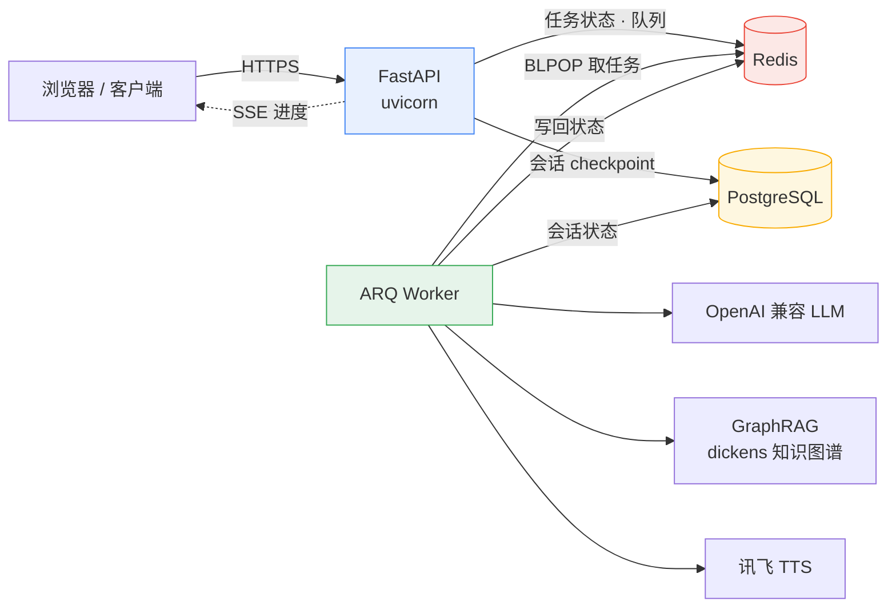
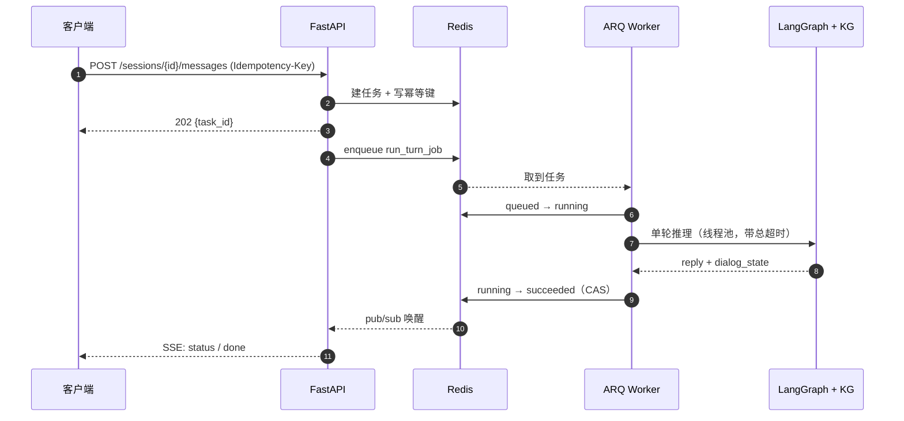
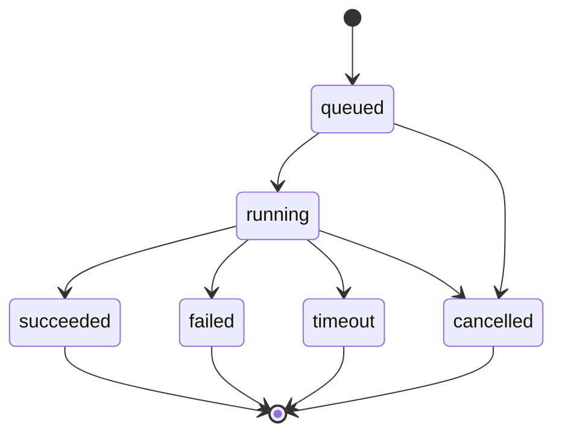

# CMeKG-Agent：麻醉术前访视 Agent 平台

基于 **LangGraph + 知识图谱（GraphRAG）** 的医疗对话 Agent，把"麻醉术前谈话"这件需要多轮问诊、
病史采集、风险告知的事，做成一条可追踪、可恢复、可水平扩展的后端流水线。

> 从"能跑通的科研 Demo"演进为"能扛并发的服务"：异步任务化、状态外置、会话可持久化、
> 失败可重试、全链路可观测。

---

## 一、它解决什么问题

麻醉术前访视要求医生按固定顺序完成：**核对身份 → 采集病史 → 介绍镇痛方案 → 告知并发症风险 → 签字确认**。
每一步都要多轮提问、记录结构化信息，并依据患者病史从医学知识图谱里检索对应的用药与风险知识。

本项目把这个流程做成 Agent：

- **多 Agent 分工**：主任医生（调度）+ 信息核对 / 病史采集 / 镇痛宣教 / 风险评估 四个专科 Agent；
- **知识图谱驱动**：从 559 节点 / 371 边的中文麻醉知识图谱检索"疾病 → 用药 → 围术期建议 → 风险"；
- **语音播报**：LLM 流式输出时按句调用讯飞 TTS，前端 SSE 增量播放；
- **工程化后端**：HTTP 只负责任务提交，推理在 worker 里跑，状态在 Redis/PG 里，随时可查、可恢复。

---

## 二、系统架构



**一次对话的时序**



**任务状态机**



状态迁移是**白名单制**：非法迁移抛 `InvalidTransition`（HTTP 409），终态冻结。

---

## 三、技术栈

| 层 | 选型 | 说明 |
|---|---|---|
| Agent 编排 | **LangGraph 1.2** | StateGraph + 条件路由 + checkpointer；主助手按固定脚本推进，专科 Agent 由 LLM 驱动 |
| LLM | **LangChain 1.6 / langchain-openai** | `gpt-4o` 对话、`gpt-4o-mini` 结构化抽取 |
| 知识图谱 | **nano-graphrag** | 全局检索模式，索引在 `dickens/`（559 实体 / 371 关系 / 541 向量） |
| Web | **FastAPI + uvicorn** | 全异步；自带极简聊天页 `app/static/chat.html` |
| 任务状态 | **Redis** | Hash 存储 + WATCH/MULTI 乐观锁 CAS + Pub/Sub 通知 |
| 会话持久化 | **PostgreSQL / SQLite / Memory** | 通过 `CHECKPOINT_BACKEND` 切换，工厂在 `app/checkpoint.py` |
| 队列 | **ARQ** | 异步 worker，与 API 进程解耦 |
| 语音 | 科大讯飞 TTS/IAT | 凭据缺失时自动降级为纯文字 |
| 可观测 | **prometheus-client + contextvars** | trace_id 贯穿日志，`/metrics` 暴露 5 个指标 |
| 质量 | pytest / ruff / mypy / GitHub Actions | 94 个用例，覆盖率 72% |

---

## 四、快速开始

### 1. 环境

```bash
conda activate cmekg-studio      # Python 3.11
pip install -r requirements.txt -r requirements-dev.txt
```

### 2. 配置

```bash
cp .env.example .env
```

**必填**：`OPENAI_API_BASE`、`OPENAI_API_KEY`
**按需**：`XUNFEI_*`（语音，缺省则降级）、`API_KEY`（接口鉴权，缺省则不校验）、
`TASK_BACKEND` / `EXECUTION_MODE` / `CHECKPOINT_BACKEND`（见下表）

### 3. 起依赖（可选）

```bash
docker compose up -d redis postgres
python scripts/check_infra.py       # 连通性自检
```

> 只用默认配置（memory + inline）时**不需要任何外部依赖**。

### 4. 启动

```bash
# API（默认 8000）
uvicorn app.main:app --host 0.0.0.0 --port 8000

# 队列模式才需要：单独起 worker
python -m arq app.worker.WorkerSettings

# 交互式命令行版（可选，需要 pip install ipython）
python main.py
```

试一下：

```bash
curl -X POST http://127.0.0.1:8000/api/v1/sessions/s-001/messages \
  -H 'Content-Type: application/json' \
  -H 'Idempotency-Key: demo-1' \
  -d '{"message":"你好，我姓张，要做胆囊切除手术"}'

curl http://127.0.0.1:8000/api/v1/tasks/<task_id>
curl -N http://127.0.0.1:8000/api/v1/tasks/<task_id>/events   # SSE
```

或者直接用浏览器打开 **http://127.0.0.1:8000/chat** —— 项目自带的极简聊天页
（提交消息 + SSE 实时状态 + 语音朗读 + 新会话），`/` 会自动跳到这里。
接口文档在 **http://127.0.0.1:8000/docs**。

页面行为说明：

- **会话由助手先开口**：新建会话时前端会发一条隐藏的引导消息（`开始术前访视`），
  不渲染成用户气泡，随后助手自我介绍并询问称呼；
- **语音**：配置了讯飞凭据就用讯飞合成；没配置时自动降级到**浏览器内置语音**
  （Web Speech API），开箱即用，不需要任何凭据。

完整接口见 **[docs/API.md](docs/API.md)**。

---

## 五、配置开关

| 变量 | 取值 | 默认 | 作用 |
|---|---|---|---|
| `TASK_BACKEND` | `memory` / `redis` | `memory` | 任务状态存哪里（多副本必须 redis） |
| `EXECUTION_MODE` | `inline` / `queue` | `inline` | 推理在 API 进程内跑，还是投给 worker |
| `CHECKPOINT_BACKEND` | `memory` / `sqlite` / `postgres` | `memory` | 会话状态持久化 |
| `TURN_TIMEOUT_SECONDS` | 整数 | `180` | 单轮总超时 |
| `TURN_MAX_ATTEMPTS` | 整数 | `3` | 瞬时错误的重试次数 |
| `RATE_LIMIT_*` | 整数 | `120 / 60s` | 限流 |
| `RATE_LIMIT_BACKEND` | `memory` / `redis` | `memory` | 多副本必须 redis，否则额度被放大 N 倍 |
| `SESSION_LOCK_BACKEND` | `memory` / `redis` | `memory` | 同会话串行的锁；多副本必须 redis |
| `TASK_LEASE_SECONDS` | 整数 | `300` | RUNNING 任务的租约，超时被 reaper 回收 |
| `API_KEY` | 字符串 | 空 | 非空即要求 `X-API-Key` |

两个开关**互不影响**：`memory + inline` 是单机开发模式，`redis + queue` 是生产模式，
中间态（redis + inline、memory + queue）也能跑，只是意义不大。

---

## 六、目录结构

```
app/                      平台层（有类型注解、有测试覆盖）
  config.py                pydantic-settings 统一配置
  tasks.py                 任务模型 + 状态机 + TaskStore 协议 + 内存实现
  store_redis.py           Redis 实现（CAS + Pub/Sub + 租约）
  dispatch.py              执行分发：Inline / ARQ
  runner.py                单轮执行：线程池 + 超时 + 重试 + 指标
  checkpoint.py            memory / sqlite / postgres 工厂
  worker.py                ARQ worker 定义
  locks.py                 会话锁：进程内 / Redis 分布式
  tts.py                   讯飞语音合成（超时 + sha1 缓存）
  observability.py         trace_id + 日志 + HTTP 指标中间件
  metrics.py               Prometheus 指标
  ratelimit.py             限流：进程内 / Redis
  api/                     routes / deps / security
  static/chat.html         自带聊天页（无构建步骤）
Graph/                     LangGraph 图定义、状态、路由、节点
Chains/                    各专科 Agent 的 prompt + chain
Prompts/  Indexes/  Tools/ 历史遗留，主流程不引用
dickens/                   GraphRAG 索引（运行时必需）
scripts/                   冒烟、自检、端到端验证、压测
docs/                      API / 架构 / 阶段说明
tests/                     94 个用例（离线可跑）
```

---

## 七、设计要点

1. **同步 Agent 不阻塞事件循环**：LangGraph 的 `invoke` 是同步阻塞 API，用
   `asyncio.to_thread` 挪到线程池，外面套 `asyncio.wait_for` 总超时。
2. **任务状态是唯一事实来源**：状态迁移用 CAS 实现（Redis `WATCH/MULTI`），
   并发两个执行者抢同一任务时只有一个能成功，避免重复写终态。
3. **幂等**：`Idempotency-Key` + 状态机双重保证；重复提交返回原 `task_id`。
4. **SSE 不轮询**：内存实现用 `asyncio.Event`、Redis 实现用 Pub/Sub 唤醒，
   空闲期靠 keep-alive 注释保活。
5. **重试只覆盖瞬时错误**：连接类 / 429 / 5xx 走指数退避；业务错误与超时立即失败，
   避免重复计费。
6. **可观测**：trace_id 用 `contextvars` 贯穿（`asyncio.create_task` 自动继承），
   指标标签用路由模板而非真实 URL，避免时间序列爆炸。

更细的取舍见 [docs/ARCHITECTURE.md](docs/ARCHITECTURE.md)。

---

## 八、验证

```bash
pytest                          # 94 passed，覆盖率 72%
ruff check app scripts tests    # All checks passed
mypy app                        # Success: no issues found in 20 source files
```

三个端到端脚本（会真实调用 LLM / 数据库，按需运行）：

| 脚本 | 验证内容 |
|---|---|
| `scripts/smoke_imports.py` | 29 个模块能否全部导入 |
| `scripts/e2e_postgres.py` | API + Postgres checkpoint + 真实一轮对话 |
| `scripts/e2e_queue.py` | Redis + ARQ **跨进程**链路（API 投递 → worker 执行 → Redis 回读） |
| `scripts/check_infra.py` | Redis / PostgreSQL 连通性自检 |
| `scripts/load_test.py` | API 层压测（推理用桩替代，测本项目自身的路径） |

---

## 九、性能基线

本机实测（Windows / Python 3.11 / 单进程 uvicorn，**推理用桩替代**，只测
「中间件 → 限流 → 建任务 → 分发 → 返回 202」这条路径）：

| 存储 | 并发 | 请求数 | 吞吐 | p50 | p95 | p99 |
|---|---|---|---|---|---|---|
| memory | 1 | 200 | 385 req/s | **2.5 ms** | 3.1 ms | 3.5 ms |
| redis | 1 | 200 | 194 req/s | **5.1 ms** | 5.8 ms | 6.4 ms |
| memory | 50 | 500 | 482 req/s | 89.9 ms | 125.7 ms | 135.5 ms |
| redis | 50 | 500 | 279 req/s | 171.9 ms | 221.8 ms | 253.3 ms |
| memory | 100 | 1000 | 480 req/s | 192.8 ms | 239.7 ms | 248.5 ms |

**怎么读这组数字：**

- 单请求开销很小：内存 2.5 ms、Redis 5.1 ms（多出来的 ~2.6 ms 是 Redis 往返）；
- 并发 50 时延迟涨到 90 ms，但吞吐只到 482 req/s —— 这是**排队**，不是变慢：
  单进程单事件循环的吞吐上限就在 480 左右；
- 并发从 50 加到 100，吞吐**不再增长**（482 → 480）、延迟翻倍（90 → 193 ms），
  典型的 `L = λW`：此时该扩副本，而不是继续加压。

> 这些是 API 层数字，**不含 LLM 推理**。真实一轮对话受模型延迟主导（秒级），
> 所以架构上才要把推理放到 worker 里、接口只返回 202。

复现：

```bash
python scripts/load_test.py --scenario memory --concurrency 1   --total 200
python scripts/load_test.py --scenario redis  --concurrency 50  --total 500
```

---

## 十、演进路线

| 阶段 | 做了什么 | 关键收益 |
|---|---|---|
| **P0** 地基 | 配置外置、去掉硬编码密钥、破除 `Graph → web.app` 反向依赖、Docker/compose | 密钥零硬编码，可容器化 |
| **P1** 异步化 | FastAPI + 任务状态机 + SSE + 取消，接口返回 202 | 提交接口 p50 **2.5 ms** / p99 3.5 ms（单并发实测），不再阻塞等待推理 |
| **P2** 持久化 | Redis 任务存储（CAS）、ARQ worker、SQLite/PG checkpoint | 重启不丢任务与会话，可水平扩容 |
| **升级** | langchain 0.1 → 1.6、langgraph 0.0.27 → 1.2 | 才能在 1.x 上装 Postgres checkpointer |
| **P2+** 韧性 | 重试退避、限流、鉴权 | 瞬时故障自愈，接口可对外 |
| **P4** 可观测 | trace_id、Prometheus、CI | 出事能查，交付能验 |

---

## 十一、Agent 编排（原始设计图）


主任医生通过 `ToHistoryAgent` / `ToRiskAgent` / `ToAnalgesiaAgent` 工具调用把任务分派给专科，
专科完成一轮后调用 `CompleteOrEscalate` 交还控制权。

---

## 十二、已知限制

- `Graph/` 与 `Chains/` 是未类型化的既有代码，mypy 对它们 `ignore_errors`，CI 只严格检查 `app/`；
- 知识图谱是离线构建的静态索引，更新需重建 `dickens/`；
- 只压了 API 层（推理用桩），没有端到端压测；
- 会话锁的租约不自动续期：单轮若超过 `SESSION_LOCK_LEASE_SECONDS` 会被后来者抢占
  （默认 300s，大于单轮超时 180s，正常不会触发）。

## License

MIT
